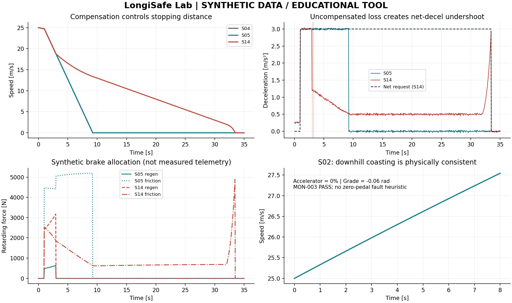

# LongiSafe Lab

**Scenario-based validation of vehicle longitudinal dynamics**
**v0.1.0-m1 | Excel/VBA + Python | Synthetic data only**

LongiSafe Lab is an offline engineering demonstrator for analyzing longitudinal vehicle behavior, with particular emphasis on regenerative braking loss, friction-brake compensation, stopping performance and signal plausibility. A deterministic Python point-mass model produces synthetic time series; a substantive Excel/VBA analyzer independently imports the measurements, evaluates monitors, computes braking metrics, creates charts and exports traceable results. Python also provides an independent numerical reference.

> **Important:** This is an educational, synthetic-data analysis tool—not vehicle-control software, a calibrated BMW model, certified functional safety software, ISO 26262/21448 compliance evidence or a real-world safety guarantee. Monitor `FAIL` denotes violation of a configurable illustrative rule, not proof a vehicle is unsafe. No real BMW telemetry is used.



## Release validation

| Evidence | Result |
|---|---|
| Windows desktop Excel VBA compile and end-to-end smoke | **10/10** expected behaviors matched, including S11 deliberate rejection |
| Excel-exported results vs independent Python reference | **9/9 PASS**, no comparison failures |
| Python pytest regression suite | **43 passed, 18 subtests passed** (reproduced on 13 November 2026) |
| Excel workbook/source synchronization | **9/9** VBA modules recovered directly from the validated workbook and byte-matched |
| Large-input Excel smoke case | **10,001 rows**, ~7.17 s in the user-reported Windows smoke run (not a universal performance guarantee) |

The included macro-enabled workbook is the actual Windows-tested `excel/LongiSafeLab.xlsm` (not an `.xlsx` renamed to `.xlsm`). `evidence/excel_smoke/` contains the unmodified 10-scenario smoke results, actual exported PDFs/CSVs from nine valid cases, and S11's expected rejection in `smoke_results.csv`. The independent checker result is under `evidence/validation/`. The reports from S05 and S14 show contrasting loss-of-regeneration behavior. [Read the complete validation record](docs/TEST_RESULTS.md).

## Reproduce the Excel application

On **Windows desktop Excel** (not Excel Online), open `excel/LongiSafeLab.xlsm` after reviewing and trusting the macros, then press `Alt+F8` and run `SmokeTestM1`. Choose `data/synthetic/S05.csv` when prompted. The routine creates `smoke_exports/` next to the workbook and executes the ten configured fixtures. The workbook retains the last processed scenario (`PERF_10001`), so a flat zero-deceleration chart after the smoke run is **expected**.

To inspect an individual scenario, run `ImportOnly` on `data/synthetic/S14.csv`, followed by `AnalyzeActive`. See [detailed Windows instructions](docs/WINDOWS_EXCEL_CHECKLIST.md) and [source synchronization notes](docs/VBA_SOURCE_SYNC.md).

Alternatively, create a new `.xlsm` and import the nine matching `.bas` modules from `excel/vba/`. The included workbook is convenient for a quick demonstration; the sources are reviewable and version-controlled. Never globally disable Office macro security to open a workbook.

## Run the Python reference

Core physics, analysis and CSV comparison use Python **3.10+** and the standard library. From the project root:

```bash
# macOS/Linux
export PYTHONPATH=python
python -m longisafe.generator --root .
python -m longisafe.cli data/synthetic/S05.csv --out reports/my-S05
python scripts/run_suite.py
python -m unittest discover -s tests -v
python scripts/check_all_excel_exports.py evidence/excel_smoke
python scripts/vba_source_sync.py
python scripts/verify_repo.py
```

On PowerShell, set `$env:PYTHONPATH = "python"`, and use `py` in place of `python`. For the optional PDF/plot generator and pytest suite, install `requirements.txt`, then run `python -m pytest -q`. The original generated datasets in `data/synthetic/` are deterministic; regenerate into a separate directory if preserving the baseline inputs matters.

## What it evaluates

| Scenario | Interpretation | Expected |
|---|---|---|
| S01 | Steady flat driving | No `FAIL` |
| S02 | Downhill coast with zero accelerator | Physically consistent, no spurious `FAIL` |
| S04 | Nominal stop | Requested braking achieved |
| S05 | Regen limitation/loss with sufficient friction substitution | `MON-005 PASS`, stopping distance ~102.06 m |
| S09 | Longitudinal acceleration sensor bias | `MON-003 FAIL` |
| S10 | Frozen speed sensor | `MON-004 FAIL` |
| S11 | Duplicate timestamp | CSV rejected by `MON-001` |
| S14 | Regen loss without sufficient friction substitution | `MON-005 FAIL`, stopping distance ~318.59 m |
| MISSING_CONTEXT | No optional deceleration-request signal | `MON-005 NOT_EVALUATED` |
| PERF_10001 | 10,001-row steady-state dataset | No `FAIL`; throughput test |

The two braking scenarios do not differ in only one parameter: S05 has a higher initial SOC and different initial regen split than S14. They illustrate two engineering outcomes, not a strictly controlled one-variable experiment. MON-006..009 and eight additional numbered scenarios are reserved for future M2 work.

## Project layout

```text
excel/LongiSafeLab.xlsm    # the actually tested workbook
excel/vba/                # nine source modules, byte-matched to XLSM
python/longisafe/         # synthetic physics, generation, analysis, schema
scenarios/configs/        # reproducible JSON scenario definitions
data/synthetic/           # input CSVs; fault truth stored separately
data/ground_truth/        # injected-event manifests for test oracle only
tests/                    # independent analytical and regression tests
scripts/                  # verification, rendering and synchronization
reports/                  # independently generated Python reports and charts
evidence/excel_smoke/      # genuine user-side Excel exports and smoke results
evidence/validation/       # Python export cross-check results
docs/                     # assumptions, contract, traceability, limitations
```

## Engineering notes

The model represents forward-only longitudinal motion with documented sign conventions, grade/drag/rolling resistance, motor and friction retardation, traction limits, stop interpolation and illustrative SOC/temperature/speed regen constraints. Excel checks time/range coherence, compares integrated acceleration with speed, detects frozen speed and persistent deceleration demand shortfalls, and computes stopping time/distance, peak/RMS jerk and mechanical braking-work share. Missing context and unimplemented monitors are explicitly `NOT_EVALUATED` rather than silently `PASS`. Synthetic fault truth is excluded from the monitor's input.

[Assumptions](docs/engineering_assumptions.md) · [Signal contract](docs/signal_dictionary.md) · [Traceability](docs/requirements_traceability.md) · [Safety scope](docs/safety_scope_and_limitations.md) · [M1 verification](docs/TEST_RESULTS.md)

**Release provenance:** This portfolio project was developed iteratively with AI-assisted coding and validated through the documented reproducible tests and actual Excel runs. The included VBA source intentionally retains harmless diagnostic `Debug.Print` statements because it is an **exact source snapshot of the validated workbook**. Removing those statements requires rebuilding/revalidating the workbook. No public open-source license has been selected; source availability does not imply permission to reuse it.

## Continuous integration

The included [GitHub Actions workflow](.github/workflows/python-validation.yml) is configured to run Python tests, archived Excel export comparisons, and VBA/workbook **source-integrity** checks on every push. GitHub Actions cannot execute desktop Windows Excel in this Linux job, so the archived owner-run Excel smoke test remains distinct. This workflow has not executed on GitHub until the repository is published.
